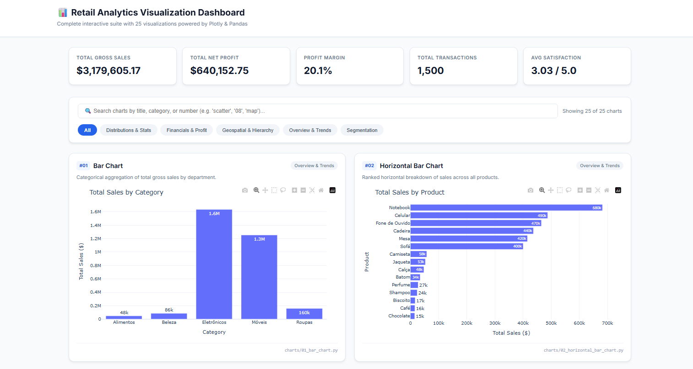

# Interactive Sales Analytics & Data Visualizations

A modular, production-ready Python suite containing **25 interactive data visualizations** built with **Plotly** and **Pandas**, driven by real-world retail sales data.

Each visualization opens an interactive browser window supporting zooming, panning, hover tooltips, and image export.

<p align="center">
  
</p>

---

## Table of Contents

- [Features](#features)
- [Project Architecture & Structure](#project-architecture--structure)
- [Prerequisites](#prerequisites)
- [Installation & Setup](#installation--setup)
- [How to Run](#how-to-run)
  - [1. Interactive Web Dashboard (All 25 Charts in One Page)](#1-interactive-web-dashboard-all-25-charts-in-one-page)
  - [2. Unified CLI Runner (Recommended for Individual Charts)](#2-unified-cli-runner-recommended-for-individual-charts)
  - [3. Run Individual Scripts Directly](#3-run-individual-scripts-directly)
- [Dataset Schema](#dataset-schema)
- [Catalog of Visualizations](#catalog-of-visualizations)
- [Software Engineering Standards & Improvements](#software-engineering-standards--improvements)
- [Running Automated Tests](#running-automated-tests)

---

## Features

- **25 Comprehensive Chart Types**: Covers categorical comparisons, time-series, distributions, statistical correlations, hierarchical trees, flows, KPIs, and geospatial choropleth maps.
- **Interactive Experience**: Interactive HTML5 visualizations powered by Plotly (hover details, dynamic filtering, box zoom, PNG snapshot export).
- **Software Engineering Best Practices**:
  - Modular design with separation of concerns (`create_figure()` returning a `go.Figure` object and `main()` managing execution).
  - Robust cross-platform path resolution using Python's `pathlib.Path`.
  - Full PEP 8 compliance, clean docstrings, and type hints.
  - Interactive CLI runner with argument parsing (`argparse`).
  - Standardized package architecture with proper `.gitignore` and pinned `requirements.txt`.

---

## Project Architecture & Structure

```text
python-graphics/
├── charts/                           # Modular chart definitions package
│   ├── __init__.py                   # Package initializer
│   ├── 01_bar_chart.py               # Bar chart: Sales by category
│   ├── 02_horizontal_bar_chart.py    # Horizontal bar chart: Sales by product
│   ├── 03_grouped_bar_chart.py       # Grouped bars: Category & segment
│   ├── 04_stacked_bar_chart.py       # Stacked bars: Category & segment
│   ├── 05_line_chart.py              # Line chart: Monthly sales trend
│   ├── 06_area_chart.py              # Area chart: Monthly cumulative trend
│   ├── 07_candlestick_chart.py       # Weekly OHLC candlestick
│   ├── 08_histogram.py               # Transaction sales distribution
│   ├── 09_box_plot.py                # Statistical box plot by category
│   ├── 10_violin_plot.py             # Kernel density violin plot
│   ├── 11_scatter_plot.py            # Sales vs. Profit scatter
│   ├── 12_bubble_chart.py            # Bubble chart (size = quantity)
│   ├── 13_3d_scatter_plot.py         # 3D scatter: Sales, Profit & Units
│   ├── 14_2d_density_heatmap.py      # 2D contour density heatmap
│   ├── 15_pie_chart.py               # Category market share
│   ├── 16_donut_chart.py             # Donut chart with cutout
│   ├── 17_funnel_chart.py            # Sales volume funnel
│   ├── 18_treemap.py                 # Multi-level hierarchical treemap
│   ├── 19_sunburst_chart.py          # Radial multi-level sunburst
│   ├── 20_waterfall_chart.py         # Profit waterfall by category
│   ├── 21_heatmap.py                 # Cross-tab matrix: Country vs Category
│   ├── 22_gauge_indicator.py         # Sales quota vs KPI target
│   ├── 23_polar_radar_chart.py       # Customer satisfaction radar
│   ├── 24_sankey_diagram.py          # Value flow: Country to Category
│   └── 25_choropleth_map.py          # Global world sales map
├── image/                            # Project assets and screenshots
│   └── image-project.png             # Dashboard preview banner
├── dashboard.py                      # Standalone web dashboard builder & server
├── dashboard.html                    # Generated self-contained HTML dashboard
├── main.py                           # CLI entrypoint and interactive menu
├── requirements.txt                  # Python dependencies
├── sales.csv                         # Source dataset (1,500 retail records)
├── .gitignore                        # Git ignore patterns
└── README.md                         # Documentation
```

---

## Prerequisites

- **Python 3.8+** (compatible up to Python 3.14+)
- Standard web browser (Chrome, Edge, Firefox, or Safari) to view the interactive plots.

---

## Installation & Setup

### 1. Clone or Navigate to the Project Directory

### 2. Create and Activate a Virtual Environment

**On Windows (PowerShell):**
```powershell
python -m venv .venv
.\.venv\Scripts\Activate.ps1
```

**On Windows (Command Prompt):**
```cmd
python -m venv .venv
.\.venv\Scripts\activate.bat
```

**On macOS / Linux:**
```bash
python3 -m venv .venv
source .venv/bin/activate
```

### 3. Install Dependencies

```bash
pip install -r requirements.txt
```

---

## How to Run

### 1. Interactive Web Dashboard (All 25 Charts in One Page)

You can launch a full-featured, responsive web dashboard showing all 25 visualizations categorized with executive KPI cards and instant search:

```bash
# Build and automatically open in your default browser:
python dashboard.py

# Or launch via the main CLI runner:
python main.py --dashboard

# Or serve via a local HTTP server (port 8050):
python dashboard.py --serve
```

Once built, you can also open `dashboard.html` directly in any web browser without needing a running server.

---

### 2. Unified CLI Runner (Recommended for Individual Charts)

The project includes an intelligent CLI dispatcher `main.py`:

#### Interactive Terminal Menu
Run with no arguments to launch an interactive selection prompt:
```bash
python main.py
```

#### List Available Visualizations
```bash
python main.py --list
```

#### Run a Specific Chart by Number or Name
```bash
# Run by chart ID number
python main.py --chart 01
python main.py --chart 8

# Run by keyword match
python main.py --chart candlestick
python main.py --chart heatmap
python main.py --chart sankey
```

---

### 3. Run Individual Scripts Directly

Every script in `charts/` is fully independent and can be executed standalone from any directory:

```bash
# Executing from the project root:
python charts/01_bar_chart.py

# Or executing from inside the charts directory (dynamic path handling works seamlessly):
cd charts
python 25_choropleth_map.py
```

---

## Dataset Schema

The visualizations analyze `sales.csv` (formerly `vendas.csv`), which contains 1,500 international retail sales transactions:

| Field | Type | Description | Example |
| :--- | :--- | :--- | :--- |
| `data` | Date (YYYY-MM-DD) | Transaction timestamp | `2023-01-01` |
| `pais` | String | Country of sale | `United States`, `Chile`, `Peru` |
| `iso_alpha` | String (ISO-3) | 3-letter Country Alpha Code | `USA`, `CHL`, `PER` |
| `categoria` | String | Broad product category | `Eletrônicos`, `Móveis`, `Roupas` |
| `produto` | String | Individual product name | `Celular`, `Cadeira`, `Sofá` |
| `segmento` | String | Customer market segment | `Consumidor`, `Corporativo`, `Governo` |
| `vendas` | Float | Transaction gross revenue ($) | `1714.50` |
| `lucro` | Float | Transaction net profit ($) | `454.38` |
| `quantidade` | Integer | Number of units purchased | `4` |
| `satisfacao` | Float | Customer rating score (1.0 to 5.0) | `4.6` |

---

## Catalog of Visualizations

| # | File | Type | Plotly Module | Purpose |
| :-: | :--- | :--- | :--- | :--- |
| **01** | `01_bar_chart.py` | Bar Chart | `plotly.express.bar` | Aggregated sales volume by product category |
| **02** | `02_horizontal_bar_chart.py` | Horizontal Bar Chart | `plotly.express.bar` | Ranked total sales per individual product |
| **03** | `03_grouped_bar_chart.py` | Grouped Bar Chart | `plotly.express.bar` | Cross-comparison of sales across categories and segments |
| **04** | `04_stacked_bar_chart.py` | Stacked Bar Chart | `plotly.express.bar` | Total segment contribution stacked per category |
| **05** | `05_line_chart.py` | Line Chart | `plotly.express.line` | Temporal monthly sales evolution with data markers |
| **06** | `06_area_chart.py` | Area Chart | `plotly.express.area` | Monthly sales trend with shaded area fill |
| **07** | `07_candlestick_chart.py` | Candlestick | `plotly.graph_objects.Candlestick` | Weekly financial OHLC (Open, High, Low, Close) metrics |
| **08** | `08_histogram.py` | Histogram + Box | `plotly.express.histogram` | Frequency distribution of transaction sales values |
| **09** | `09_box_plot.py` | Box Plot | `plotly.express.box` | Medians, quartiles, and outlier detection by category |
| **10** | `10_violin_plot.py` | Violin Plot | `plotly.express.violin` | Probability density curves combined with internal box plots |
| **11** | `11_scatter_plot.py` | Scatter Plot | `plotly.express.scatter` | Correlation analysis between sales value and net profit |
| **12** | `12_bubble_chart.py` | Bubble Chart | `plotly.express.scatter` | Multi-variable analysis: Sales vs Profit vs Units Sold |
| **13** | `13_3d_scatter_plot.py` | 3D Scatter Plot | `plotly.express.scatter_3d` | 3-axis volumetric scatter: Sales × Profit × Quantity |
| **14** | `14_2d_density_heatmap.py` | 2D Density Heatmap | `plotly.express.density_heatmap` | Bivariate kernel concentration of sales transactions |
| **15** | `15_pie_chart.py` | Pie Chart | `plotly.express.pie` | Percentage market share per category |
| **16** | `16_donut_chart.py` | Donut Chart | `plotly.express.pie` | Donut chart with centered hole for proportional breakdown |
| **17** | `17_funnel_chart.py` | Funnel Chart | `plotly.express.funnel` | Category rankings displayed as a descending sales funnel |
| **18** | `18_treemap.py` | Treemap | `plotly.express.treemap` | Nested hierarchical rectangles: Country > Category > Product |
| **19** | `19_sunburst_chart.py` | Sunburst Chart | `plotly.express.sunburst` | Concentric radial rings representing sales hierarchies |
| **20** | `20_waterfall_chart.py` | Waterfall Chart | `plotly.graph_objects.Waterfall` | Incremental profit contribution by category up to total |
| **21** | `21_heatmap.py` | Matrix Heatmap | `plotly.express.imshow` | Pivot table matrix showing sales for Country × Category |
| **22** | `22_gauge_indicator.py` | Gauge / Indicator | `plotly.graph_objects.Indicator` | Speedometer gauge tracking total sales vs $3M target |
| **23** | `23_polar_radar_chart.py` | Polar / Radar Chart | `plotly.express.line_polar` | Multi-attribute radial evaluation of customer satisfaction |
| **24** | `24_sankey_diagram.py` | Sankey Diagram | `plotly.graph_objects.Sankey` | Directed flow paths of revenue from countries to categories |
| **25** | `25_choropleth_map.py` | Choropleth Map | `plotly.express.choropleth` | World map colored by total country revenue using ISO-3 codes |

---

## Software Engineering Standards & Improvements

The codebase underwent a complete architectural overhaul to adhere to modern software engineering standards:

1. **Deterministic Path Resolution (`pathlib`)**:
   - Replaced fragile relative string paths (`pd.read_csv("vendas.csv")`) with `Path(__file__).resolve().parent.parent / "sales.csv"`.
   - Prevents `FileNotFoundError` regardless of the process working directory (`cwd`).
2. **Standardized Directory Naming**:
   - Renamed legacy `Gráficos/` (which contained non-ASCII accent characters) to `charts/`, ensuring seamless cross-platform and git compatibility.
3. **Bug Fixes**:
   - **Histogram (`08_histogram.py`)**: Fixed an issue where `x="categoria"` was plotted instead of transaction amounts (`x="vendas"`), which was contrary to the intended sales value frequency distribution.
   - **Waterfall (`20_waterfall_chart.py`)**: Normalized totals computation and connector line styling.
4. **Modularity & Reusability**:
   - Each script exposes a `create_figure() -> go.Figure` function, decoupling data processing and figure creation from GUI presentation (`fig.show()`).
   - Enables automated headless unit testing, batch rendering, and integration into web dashboards (e.g., Dash or Streamlit).
   - Encapsulated execution with standard `if __name__ == "__main__":` entry points.
5. **Full Internationalization (English)**:
   - All source code, comments, docstrings, variable identifiers, function names, file names, chart titles, and axis labels are standardized in English.
6. **Unified CLI & Version Control**:
   - Added `main.py` dispatcher supporting interactive selection, listing, and direct argument flags.
   - Added a comprehensive `.gitignore` avoiding accidental commits of virtual environments and cache artifacts.
   - Updated `requirements.txt` with compatible version bounds.

---

## Running Automated Tests

To verify that all 25 charts generate figures without runtime errors or missing data dependencies:

```bash
python -c "
from pathlib import Path
import unittest.mock as mock
import plotly.graph_objects as go
import importlib

mock.patch.object(go.Figure, 'show', lambda self, *args, **kwargs: None).start()

for f in sorted(Path('charts').glob('*.py')):
    if f.name == '__init__.py': continue
    mod = importlib.import_module(f'charts.{f.stem}')
    fig = mod.create_figure()
    assert fig is not None
    print(f'[PASS] {f.name}')

print('\nAll 25 charts validated successfully!')
"
```
